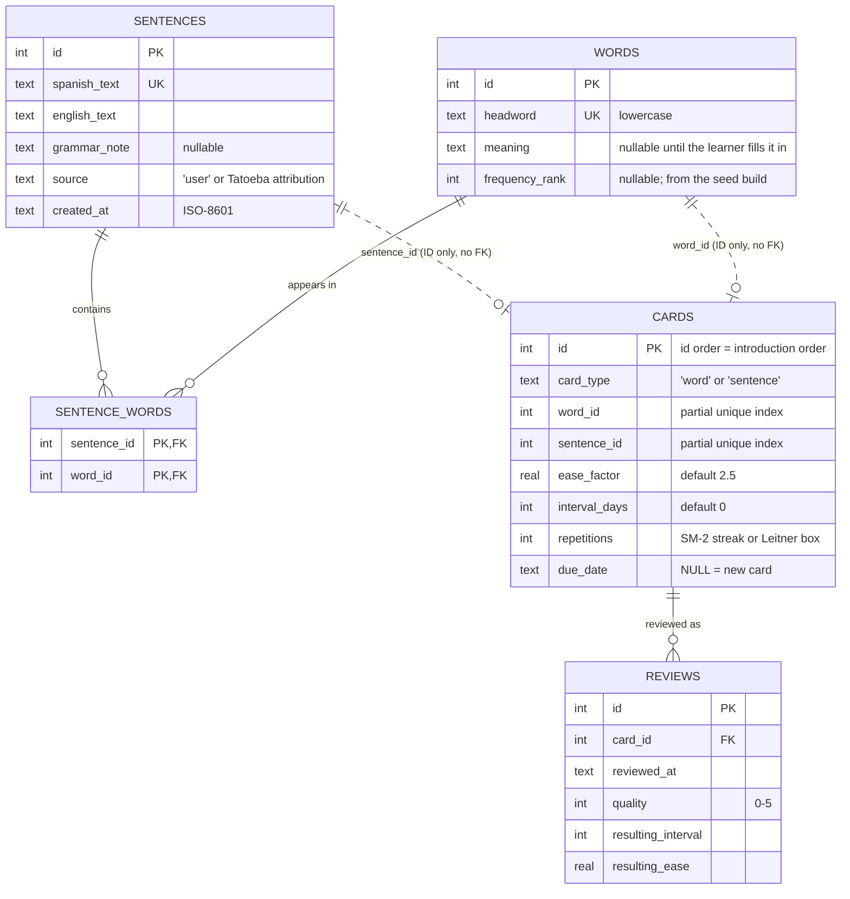

# Diagrams

## Entity-relationship diagram

Solid lines are real foreign keys, which exist only inside a domain.
Dashed lines are plain ID references across the domain boundary, with no foreign key (see ADR-3).

The content domain owns `sentences`, `words` and `sentence_words`.
The scheduler domain owns `cards` and `reviews`.
