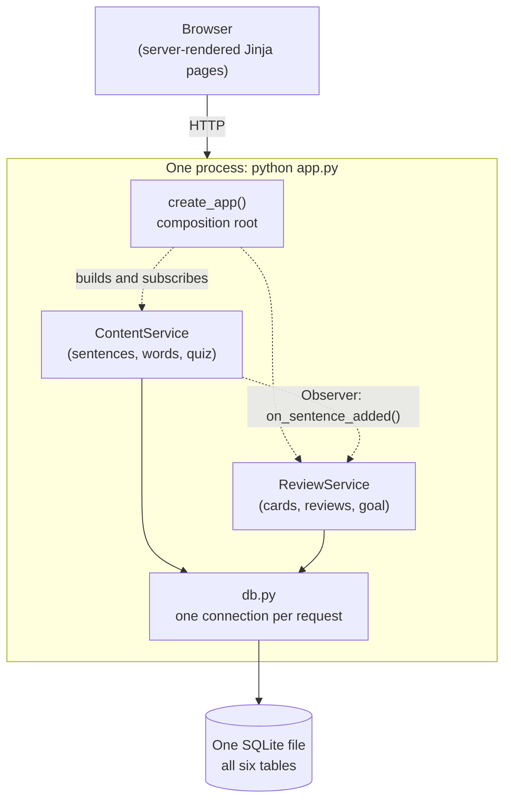
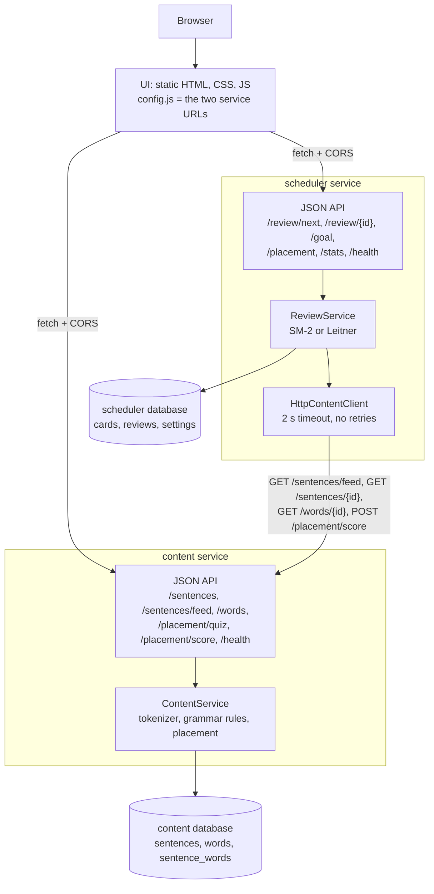
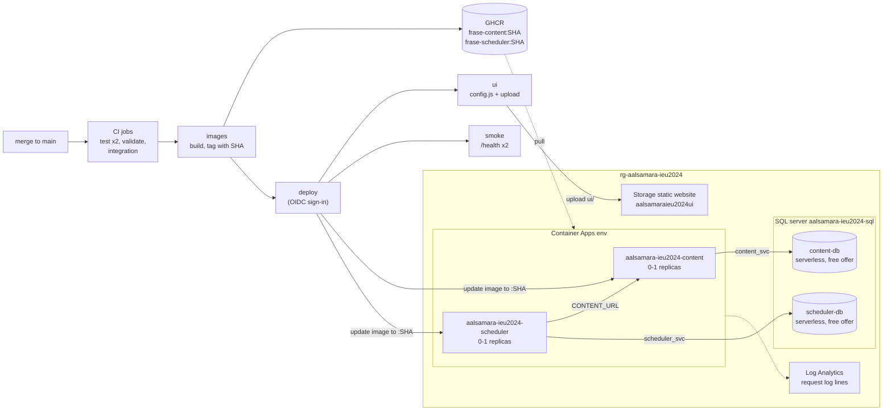
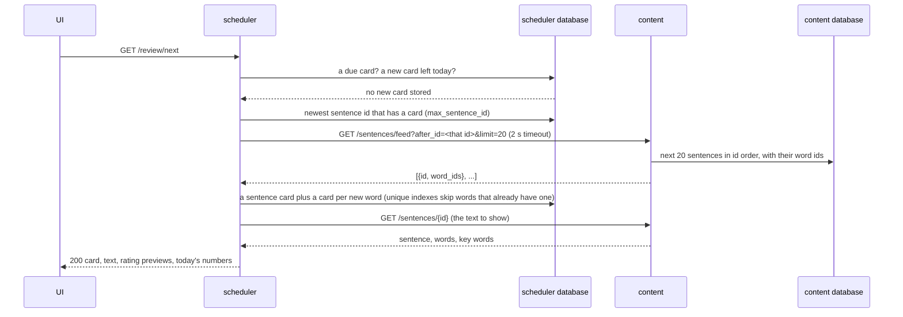
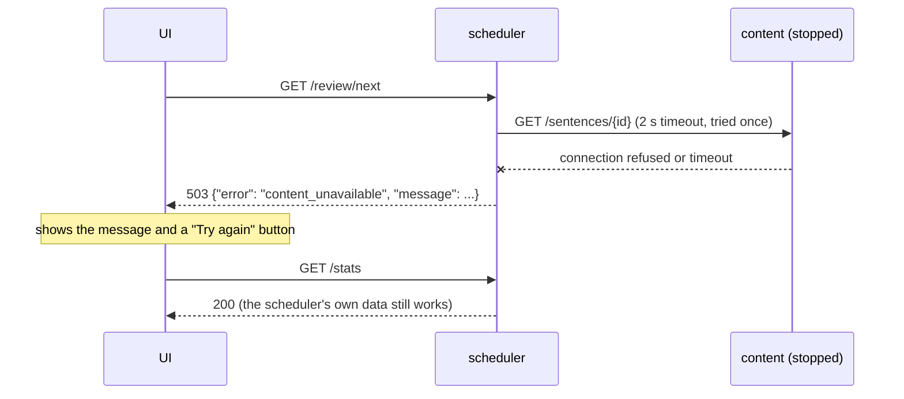
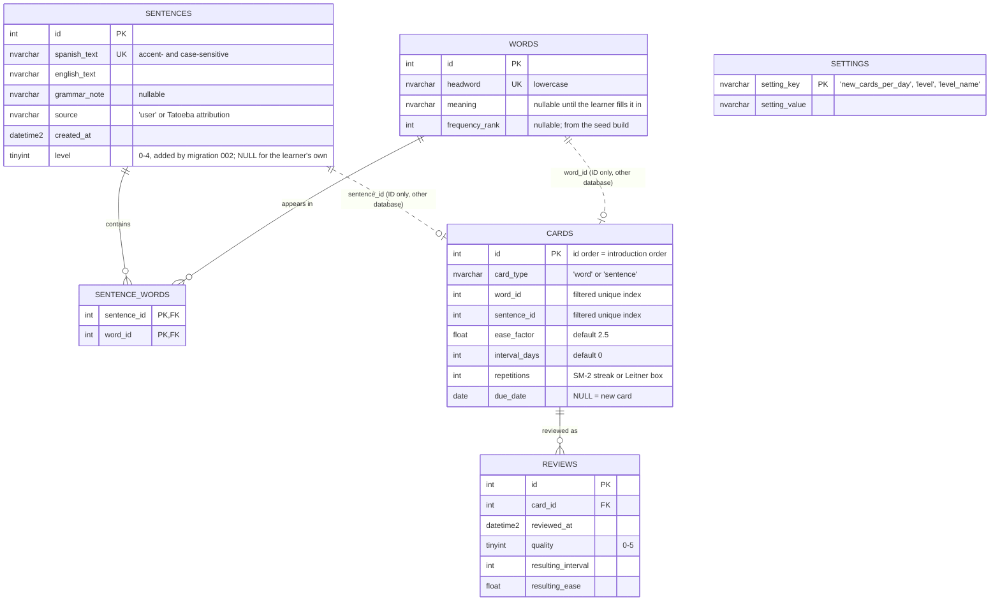

# Diagrams

## Before: the Assignment 1 monolith

One Flask process and one SQLite file. The two domains lived in one codebase and never imported each other: `create_app()` wired them together, and new sentences reached the scheduler through an in-process Observer call.

## After: two services, two databases, a static UI

Each service has its own code, image, migrations and database. The only connection between them is HTTP: the scheduler calls 4 content endpoints, each with a timeout. Content never calls the scheduler.

## Deployment

Everything on the right lives in one resource group, `rg-aalsamara-ieu2024` (Azure for Students, France Central). The pipeline signs in as the managed identity `aalsamara-ieu2024-github` through OIDC; that identity is Contributor on this resource group only.

## The pull: how the scheduler gets new cards

## When content is down

## One database per service

Solid lines are real foreign keys, which exist only inside one database. Dashed lines are plain IDs that point into the other service's database, with no foreign key possible (ADR-3, ADR-7). Content never deletes sentences or words, so those IDs stay valid.

The content database (`sentences`, `words`, `sentence_words`) belongs to the content service, and the scheduler database (`cards`, `reviews`, `settings`) to the scheduler. Each database also has `schema_migrations` (which migrations ran) and `health_check` (one row that `/health` writes to).
