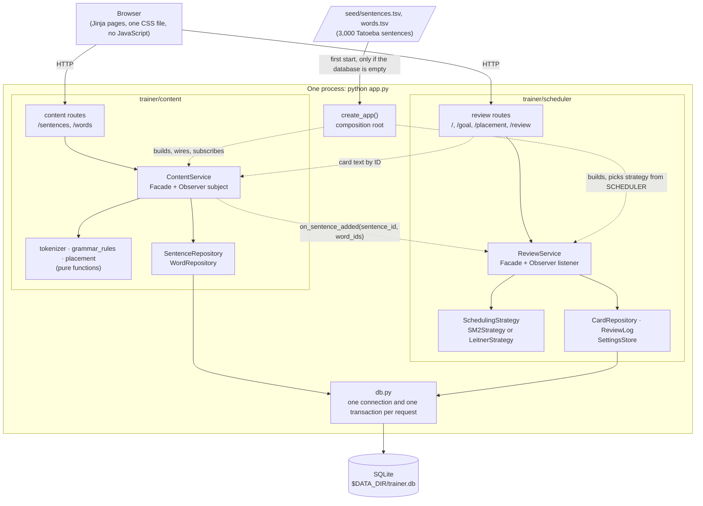
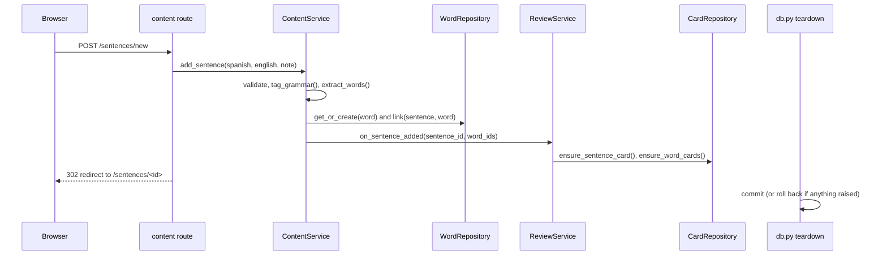
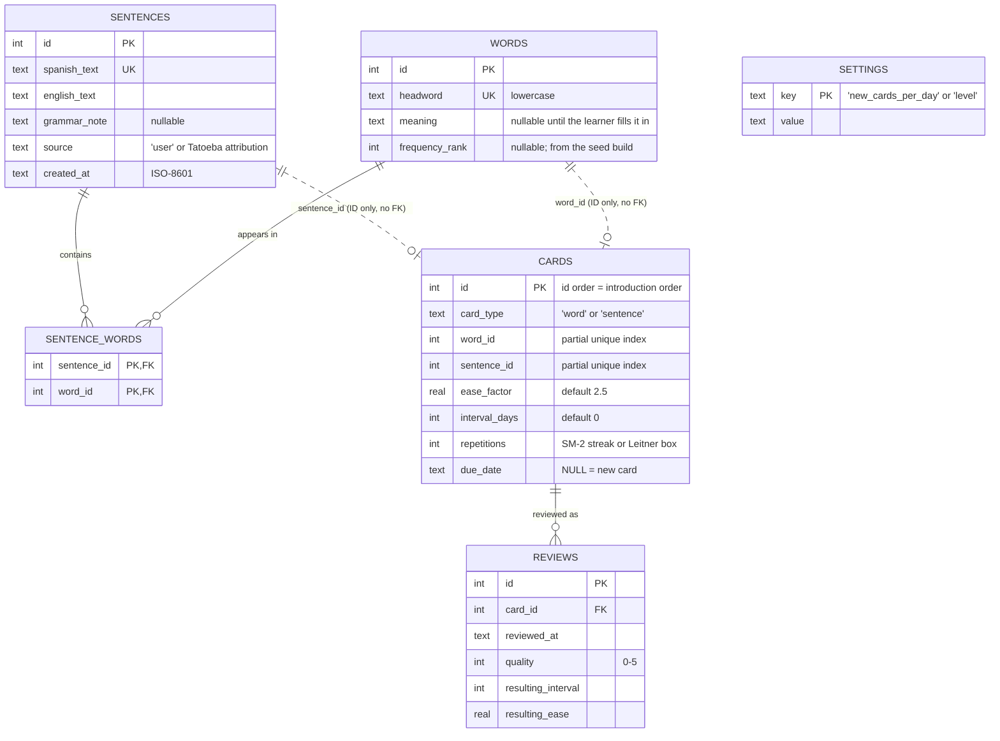

# Diagrams

## Architecture

One Flask process and one SQLite file. The two domains never import each other: `create_app()`
(the composition root) builds both facades and subscribes the scheduler to new sentences (ADR-2).
The review routes are the only code that calls both facades: `ReviewService` picks the card by ID,
then `ContentService` supplies the text to show.

Solid arrows are calls. Dashed arrows are the wiring done once at startup, the Observer
notification, and the one place where a route reads from the other domain.

## Adding a sentence: from the form to the new cards

## Entity-relationship diagram

Solid lines are real foreign keys, which exist only inside a domain.
Dashed lines are plain ID references across the domain boundary, with no foreign key (see ADR-3).

The content domain owns `sentences`, `words` and `sentence_words`.
The scheduler domain owns `cards`, `reviews` and `settings` (the learner's daily goal and quiz level).
